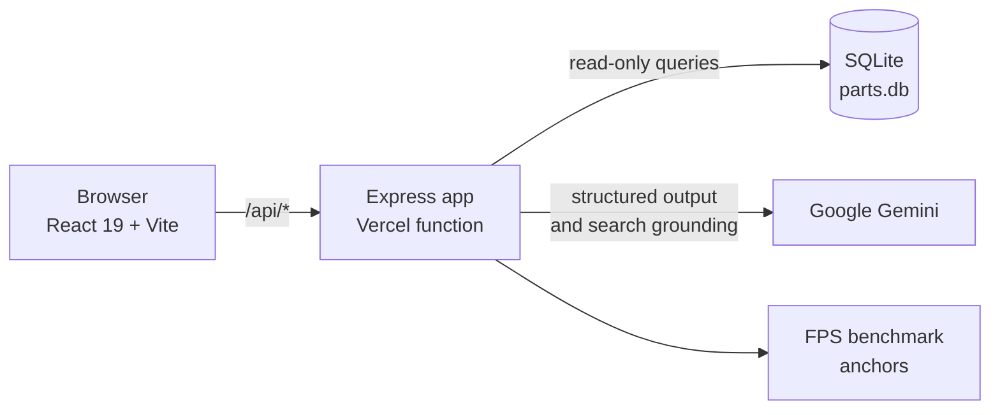
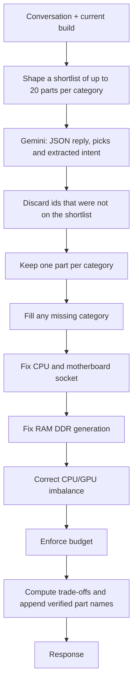

# Komponent

**An AI PC-build advisor that recommends complete, compatible builds from real parts and real local prices.**

Describe your budget and what the PC is for, in plain language. Komponent returns a full eight-part build priced from two PC retailers in Cambodia, then lets you swap parts, check the balance between CPU and GPU, see estimated frame rates, and download a written report as a PDF.

Built at [HACKATHON NAME] in September 2026 · [RESULT] · Live demo: [LIVE URL]

> **Design principle: the LLM proposes, deterministic code verifies.**
> A language model is good at understanding "I want something quiet for 1440p and I already own a case". It is not reliable at guaranteeing that a CPU fits a motherboard. So the model handles the conversation, and ordinary code checks and corrects every build before a user sees it.

## Features

- **Conversational build chat.** Reads budget, use case, resolution, platform, brand preferences and parts you already own from free-form conversation. It asks a clarifying question when it doesn't have enough to go on, and answers general PC questions without forcing a build.
- **Compatibility and budget enforcement.** Socket matching, DDR generation matching, CPU/GPU balance and total cost are corrected in code after the model responds.
- **Part swapping and search.** Replace any part from nearby-priced alternatives or a name search. Changing platform automatically re-pairs the CPU or motherboard.
- **Instant balance and FPS checks.** The bottleneck verdict and estimated FPS across five games update after every CPU or GPU swap, with no model call.
- **Trade-off scenarios.** "What if" suggestions, such as the best upgrade for about $120 more, are computed from the catalog rather than written by the model.
- **Build report with PDF export.** An on-demand report covering each part's fit, reputation and how the parts work together, researched with Google Search grounding when available.
- **Local pricing.** Where both retailers stock a part, the interface shows the real price range and which store has which price.
- **Responsive storefront.** A browsable product site with a mobile navigation menu and animated interactions.

## Architecture



The same Express app runs in both environments. [`server/app.js`](server/app.js) defines the routes, [`server/index.js`](server/index.js) adds a listener for local development, and [`api/index.js`](api/index.js) exports the app as a single Vercel function.

### How a build is produced

Every `POST /api/build-chat` request goes through this pipeline:



Order matters: budget enforcement runs last so that it has the final say on cost, and its filters preserve the socket and memory fixes made before it. Full reasoning is in the [decision log](docs/DECISIONS.md).

## Tech stack

| Area | Technology |
|---|---|
| Frontend | React 19, TypeScript, Vite, Tailwind CSS 4, Framer Motion, jsPDF |
| Backend | Node.js, Express 5 |
| Data | SQLite through better-sqlite3 (read-only at runtime) |
| AI | Google Gemini (`gemini-3.5-flash-lite`) through `@google/genai`, with JSON schema output and Google Search grounding |
| Hosting | Vercel (static frontend and one serverless function) |

## Catalog

533 parts across 8 categories (CPU, motherboard, GPU, RAM, storage, cooling, power supply, case), from a point-in-time snapshot of two Cambodian retailers taken on 2026-09-18. 29 parts are listed by both retailers.

To change the catalog, edit the listing arrays in [`server/seed.js`](server/seed.js) and run `npm run seed`.

## API

| Method | Route | Purpose | Uses LLM |
|---|---|---|---|
| `POST` | `/api/build-chat` | Conversation turn; returns reply, picks, bottleneck, budget, resolution | Yes |
| `POST` | `/api/build-report` | Written report for a build, with a `grounded` flag | Yes |
| `GET` | `/api/parts/alternatives` | Swap candidates by price proximity or name search | No |
| `GET` | `/api/bottleneck` | CPU/GPU balance verdict | No |
| `GET` | `/api/fps-estimate` | Estimated FPS across five games | No |
| `POST` | `/api/chat` | Streaming chat (not used by the current frontend) | Yes |

## Running locally

Requires Node.js and a [Gemini API key](https://ai.google.dev/).

```bash
npm install
```

Create a `.env` file in the project root:

```
GEMINI_API_KEY=your-api-key-here
SERVER_PORT=8787
```

Then run the API and the frontend in two terminals:

```bash
npm run server   # API on http://localhost:8787
npm run dev      # Frontend on http://localhost:5173, proxies /api to the server
```

`server/parts.db` is committed, so seeding is only needed after changing the catalog.

## Deployment

Import the repository into Vercel and set `GEMINI_API_KEY` as an environment variable. [`vercel.json`](vercel.json) routes `/api/*` to the function, bundles `parts.db` with it and sets a 30-second limit.

## Known limitations

This began as a hackathon project, and these are the things I would address next.

- **No automated tests.** The guard pipeline is pure logic and the best place to start.
- **Prices are a snapshot**, not a live feed, and need re-scraping to stay current.
- **The bottleneck check is a heuristic.** It compares each part's price percentile within its category and has no benchmark data behind it.
- **FPS figures are estimates.** They come from 10 anchor GPUs, using sourced and interpolated numbers. They are not measurements of a specific system.
- **The public API is unprotected.** CORS is open and the Gemini-backed endpoints have no rate limiting.
- **Some leftovers remain:** the unused `/api/chat` route and `searchPartsByName`, the `figma-make-app` package name, a stale "~600 GPUs" comment in `server/benchmarks.js`, and a single 815 kB JavaScript bundle with no code splitting.

## Project documentation

- [Project history](docs/PROJECT_HISTORY.md): every commit, what changed and why
- [Decision log](docs/DECISIONS.md): the main technical decisions and their trade-offs

## AI assistance

Built with AI pair-programming (Claude); product direction and technical decisions were mine.

## Author

Visessvitia Nuon · [GitHub](https://github.com/NUON-Visessvitia)
